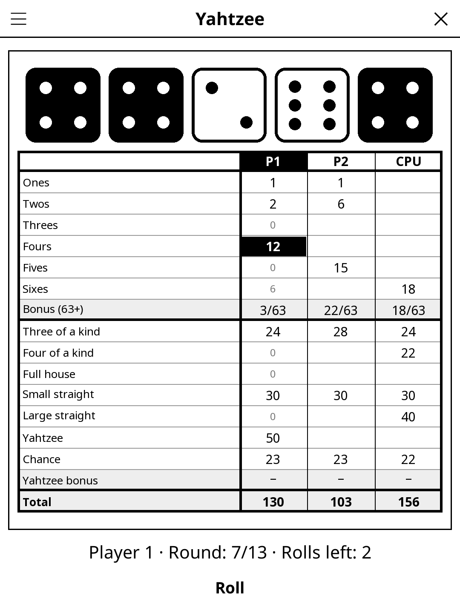

# Yahtzee — KOReader Plugin

> The classic five-dice game (Yam's in French): roll, hold, and fill your
> 13-box score sheet. Solo, hotseat for up to four, or against the computer.

## Screenshot

## Rules

Each turn, roll the five dice up to three times, holding any dice you like
between rolls, then score them in one empty box of your sheet. After 13
rounds every box is filled and the highest total wins.

| Box | Scores |
|-----|--------|
| Ones … Sixes | sum of the dice showing that face |
| Upper bonus | +35 when Ones–Sixes total 63 or more |
| Three / Four of a kind | sum of all five dice, with 3 / 4 alike |
| Full house | 25 (three of one face + two of another) |
| Small / Large straight | 30 (four in a row) / 40 (five in a row) |
| Yahtzee | 50 (five alike) |
| Chance | sum of the dice |

**Extra Yahtzees** (official Hasbro rules): once the Yahtzee box holds 50,
each further Yahtzee earns a 100-point bonus and is placed by the *forced
Joker* rule — the matching upper box if it is empty; otherwise any lower
box, at full value (25 / 30 / 40 for the full house and straights);
otherwise any upper box for zero. A Yahtzee box scored 0 earns no bonus.

## Controls

| Action | Control |
|--------|---------|
| Roll | **Roll** |
| Hold / release a die | tap it (held dice are drawn black) |
| Score a box | tap its row once (it is highlighted with its score), tap again to confirm |
| Players, computers, new game, best score, rules | title-bar menu |

Grey numbers in the current player's column show what each open box would
score with the dice on the table.

## Players

One to four human players share the device (hotseat), plus up to three
computer players (four seats in all). Humans play first, then the
computers. The best score of any human player is kept and shown in the
menu.

## Computer player

The computer keeps dice by exact expected value over the remaining rolls of
the turn: there are only 252 distinct hands and 462 distinct sets of kept
dice, so the full two-roll lookahead takes a few milliseconds. The value of a
finished hand is the best box's score minus what that box is typically worth
over a game, plus a pull towards the upper bonus — greedy across turns,
exact within one.

Measured over 1000 simulated solo games: **average 240.7** (sd 60, min 113,
max 622), upper bonus reached in 32 % of games, Yahtzee scored in 35 %.
Worst whole turn: 15 ms here (17 ms with the JIT off).

## License

GPL-3.0
